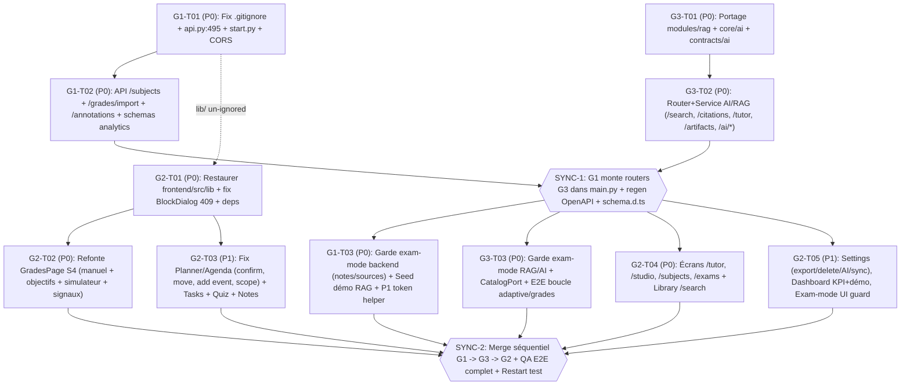

# Ensora+ — Plan d'Exécution, Graphe de Dépendances et Stratégie Git

**Objectif :** Livrer une application Ensora+ 100% compilable, stable, testée et démontrable (parcours jury complet : Sources/Import → Bibliothèque & Recherche Hybride → AI Tutor sourcé → Learning Studio → Grade Tracker S4 & Simulateur → Smart Planner → Focus/Quiz/Flashcards → Maîtrise & Replan → Redémarrage).

---

## 1. Répartition des 3 agents développeurs

| Agent | Rôle | Périmètre fonctionnel | Worktree / Branche dédiée |
|---|---|---|---|
| **Agent 1 (Gemini 1)** | Backend, Data, API, DB & Intégrations | Fix P0 `.gitignore` & `ingestion/api.py:495`, `scripts/start.py` unifié `:8000`, CORS/auth proxy, façade `/api/v1/subjects` & `/annotations`, bridge `POST /api/v1/grades/import` (Pamplemousse → P3 Grades), montage des routers RAG/AI d'Agent 3 dans `main.py`, garde backend mode examen sur notes/sources, seed démo enrichi (doc RAG synthétique), schémas Pydantic `/analytics/*` & régénération OpenAPI. | `/home/ensai/ensora-agents/backend` (`agent/1-backend`) |
| **Agent 2 (Gemini 2)** | Frontend, UX, UI & Consommation API | Restauration `frontend/src/lib/{time.ts,subjects.ts}`, fix crash 409 `BlockDialog` + boutons Confirmer/Déplacer/Ajouter événement/Périmètre examen, refonte `GradesPage` sur `/api/v1/grades/*` (S4 P0 complet : manuel + import Pamplemousse + objectifs + requis + simulateur + scénarios + règles + lien planner), création écrans `/subjects`, `/tutor`, `/studio`, `/exams`, upgrade `/library` (recherche hybride + citations), `/quiz` (création), `/tasks` (décomposition + édition/verrou), `/notes` (aperçu MD/LaTeX + versions + erreurs), `/settings` (export/delete + prefs IA + schedule sync), `/dashboard` (KPI notes + tâches + bandeau démo), garde mode examen UI + tests Vitest. | `/home/ensai/ensora-agents/frontend` (`agent/2-frontend`) |
| **Agent 3 (Gemini 3)** | Business Logic, Algorithms, Planning, Academic, RAG & AI | Portage et durcissement de `backend/app/modules/rag/**`, `backend/app/contracts/ai.py` et `backend/app/core/ai.py` depuis `/home/ensai/hackathon_ENSORA`, création du module `backend/app/modules/ai/` (router + service pour `/search`, `/citations/{id}`, `/rag/reindex`, `/tutor/answer`, `/conversations`, `/artifacts/generate`, `/artifacts`, `/ai/providers`, `/ai/preferences`), adaptateur multi-provider transparent (Ollama local + env cloud opt-in + mode extractif/démo clairement étiqueté), garde mode examen dans RAG/AI, implémentation `CatalogPort` réel, vérification/fix de la boucle Grades→Signals→Planner et tests unitaires+intégration RAG/AI. | `/home/ensai/ensora-agents/business-ai` (`agent/3-business-ai`) |

---

## 2. Graphe de dépendances et Chemin Critique

### Chemin critique (Critical Path)
`G3-T01` (Portage RAG/AI) → `G3-T02` (Endpoints RAG/AI/Studio) → **`SYNC-1`** (Montage dans `main.py` par G1 + OpenAPI) → `G2-T04` (UI `/tutor`, `/studio`, `/subjects`, `/library` hybride) → **`SYNC-2`** (Intégration + E2E complet).

**Parallélisation maximale :**
- Dès T=0, **G2 ne bloque pas sur SYNC-1** : G2 peut immédiatement exécuter `G2-T01` (fix build + BlockDialog 409), `G2-T02` (GradesPage S4 sur les endpoints `/api/v1/grades/*` **déjà existants** !), et `G2-T03` (Planner confirm/move/add, Tasks decompose, Quiz create, Notes MD/LaTeX/versions/errors — tous sur des endpoints **déjà existants** !).
- Pendant ce temps, **G1** débloque les bugs P0 backend (`G1-T01`, `G1-T02`) et **G3** porte + câble tout le moteur RAG/AI (`G3-T01`, `G3-T02`).

---

## 3. Points de synchronisation interagents

| Point | Déclencheur | Producteur → Consommateur | Contrat / Action attendue |
|---|---|---|---|
| **SYNC-0** (immédiat) | Gel de `.coordination/API_CONTRACTS.md` | Tech Lead → G1, G2, G3 | Tous les agents codent strictement contre les DTOs figés dans `.coordination/API_CONTRACTS.md`. |
| **SYNC-1** (mi-parcours) | `G1-T01`, `G1-T02`, `G3-T01`, `G3-T02` terminés | G3 → G1 → G2 | 1. G3 pousse/commit `modules/rag/`, `modules/ai/`, `core/ai.py`, `contracts/ai.py`. 2. G1 intègre les routers `rag_ai_router` et `catalog_router` dans `backend/app/main.py`, lance `pytest` + `python -m tests.contract.handoff`, et régénère l'OpenAPI. 3. G2 consomme les endpoints réels (ou s'aligne sur l'OpenAPI) pour `G2-T04` et `G2-T05`. |
| **SYNC-2** (final) | Toutes les tâches P0/P1 terminées | G1, G2, G3 → Tech Lead | Intégration séquentielle dans `integration/ensora-final` dans l'ordre **1) `agent/1-backend` → 2) `agent/3-ai-logic` → 3) `agent/2-frontend`**, résolution de conflits, exécution complète `TEST_PLAN.md` (pytest + vitest + build + démarrage live + E2E + restart). |

### Gestion des blocages interagents
Tout blocage est consigné dans le fichier `AGENT_<N>_STATUS.md` du consommateur avec le format :
`BLOCKED_BY: <Agent producteur> | CONTRACT: <endpoint/symbol> | NEEDED: <modification exacte> | WORKAROUND: <contournement temporaire éventuel>`.

---

## 4. Stratégie Git, Environnements Isolés et Protocole de Communication Live

### 4.1 Worktrees isolés et ports/bases dédiés (zéro base mutable partagée)

| Rôle | Branche | Worktree | Port API | Port UI | Base SQLite P3 / Store P1 isolés |
|---|---|---|---|---|---|
| **Smart Planner / Intégration** | `integration/ensora-final` | `/home/ensai/ensora-final` | `8000` | `5173` | `data/runtime/ensora.db` / `~/.local/share/ensora-plus` |
| **Agent 1 (Backend/Data)** | `agent/1-backend` | `/home/ensai/ensora-agents/backend` | `8001` | — | `/tmp/ensora-agent1/ensora.db` / `/tmp/ensora-agent1/p1` |
| **Agent 2 (Frontend/UI)** | `agent/2-frontend` | `/home/ensai/ensora-agents/frontend` | `8002` (ou proxy `8000`) | `5174` | `/tmp/ensora-agent2/ensora.db` / `/tmp/ensora-agent2/p1` |
| **Agent 3 (Business/AI/RAG)** | `agent/3-business-ai` | `/home/ensai/ensora-agents/business-ai` | `8003` | — | `/tmp/ensora-agent3/ensora.db` / `/tmp/ensora-agent3/p1` |

> **Règle d'isolation stricte :** aucun agent n'écrit dans `~/.local/share/ensora-plus/ensora.sqlite3` ni dans `data/runtime/ensora.db` d'un autre worktree pendant ses tests. Utiliser `DATABASE_URL` + `LOCAL_DATA_DIR` pointant vers `/tmp/ensora-agent<N>/...` (ou `tmp_path` en `pytest`).
> **Python venv partagé en lecture :** `/home/ensai/hackathon_ENSORA/.venv/bin/{python,pytest,uvicorn}` (ne pas recréer un venv de 500 Mo par worktree sauf besoin explicite).

### 4.2 Protocole de communication interagents (sans attendre un merge)

1. **Source d'arbitrage et décisions actualisées (Smart Planner) :** tous les agents lisent directement `/home/ensai/ensora-final/.coordination/{EXECUTION_PLAN,API_CONTRACTS,FILE_OWNERSHIP,TEST_PLAN}.md` avant chaque nouvelle tâche et après chaque point de synchro.
2. **Lecture directe des rapports STATUS inter-worktrees :** chaque agent écrit uniquement dans son propre `.coordination/AGENT_<N>_STATUS.md` (dans son worktree) ET consulte en lecture seule les fichiers `STATUS` live des deux autres worktrees :
   - Statut Agent 1 : `/home/ensai/ensora-agents/backend/.coordination/AGENT_1_STATUS.md`
   - Statut Agent 2 : `/home/ensai/ensora-agents/frontend/.coordination/AGENT_2_STATUS.md`
   - Statut Agent 3 : `/home/ensai/ensora-agents/business-ai/.coordination/AGENT_3_STATUS.md`
3. **Historique versionné :** chaque agent commite son `AGENT_<N>_STATUS.md` avec ses commits de code sur sa branche. Le Smart Planner lit les 3 fichiers `STATUS` live pour arbitrer tout changement de contrat ou conflit, puis fusionne séquentiellement.

### 4.3 Règles Git strictes et ordre d'intégration

1. Chaque agent travaille **uniquement** dans son worktree, sur sa branche, et sur les fichiers de `.coordination/FILE_OWNERSHIP.md`.
2. Commits atomiques et conventionnels : `fix(p1): ...`, `feat(rag): ...`, `feat(grades-ui): ...`.
3. **Interdiction absolue** : `git reset --hard`, `git push --force`, modification de fichiers hors propriété, commit de bases `.db`/`.sqlite3`/`.env`/`api-token`/secrets.
4. **Ordre d'intégration dans `integration/ensora-final` (piloté uniquement par Smart Planner) :**
   - Étape 1 : `git merge --no-ff agent/1-backend` → vérifier `pytest backend/tests`.
   - Étape 2 : `git merge --no-ff agent/3-business-ai` → connecter `ai_router` dans `main.py` si nécessaire → vérifier `pytest backend/tests` (100% vert).
   - Étape 3 : `git merge --no-ff agent/2-frontend` → régénérer `frontend/src/api/schema.d.ts` → vérifier `npm run typecheck && npm run lint && npm test && npm run build`.
   - Étape 4 : Lancement complet Uvicorn (`:8000`) + Vite (`:5173`), test de bout en bout du parcours jury + test redémarrage.
