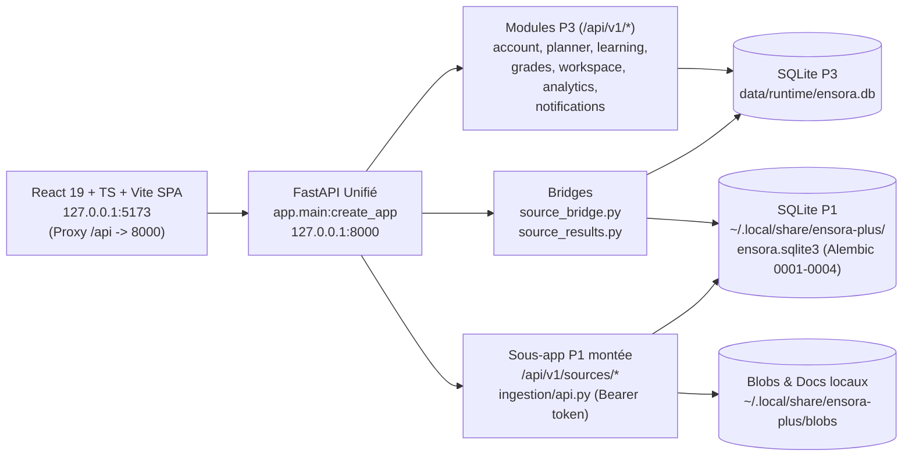

# Ensora+ — Contexte Projet, Architecture et Sources de Vérité

**Date d'audit :** 2026-11-28  
**Branche de référence :** `integration/ensora-final` (`d4e09de`, alignée avec `origin/Fan-y-h`)  
**Workspace intégration :** `/home/ensai/ensora-final`  
**Mode :** Coordination multiagents (3 agents développeurs : Gemini 1, Gemini 2, Gemini 3)

---

## 1. Mission et vision produit

Moderniser le Drive partagé du club de tutorat Ensora (ENSAI) en un **espace de travail web local-first, intelligent et adaptatif** pour les étudiants ENSAI (1A, 2A, 3A et filières/spécialisations).

L'application relie dans une **boucle pédagogique fermée** :
1. **Sources autorisées en lecture seule** (Moodle, Pamplemousse, Drive Ensora, Google Calendar, imports locaux et académiques) ;
2. **Catalogue / Bibliothèque & RAG** (parsing multi-formats, indexation hybride, recherche avec citations exactes vers la version locale) ;
3. **Grade Tracker & Academic Optimizer (S4 — P0)** (hiérarchie récursive UE/matières/évaluations, moyennes déterministes en `Decimal`, objectifs, notes requises, simulations non mutantes, règles officielles versionnées, signaux académiques) ;
4. **Smart Planner contraint** (disponibilités, limites journalières/hebdomadaires, verrous, prérequis, deadlines, aperçu/diff, acceptation atomique avec contrôle de révision, replanification dynamique) ;
5. **AI Tutor & Learning Studio** (génération à la demande uniquement — jamais anticipée au planning —, multi-fournisseurs avec routeur par politique et consentement explicite, mode examen bloquant IA et corrigés) ;
6. **Apprentissage adaptatif, Focus Room, Smart Notes & Analytics** (flashcards, quiz, examens blancs chronométrés, maîtrise multi-dimensions fondée sur preuves objectives, carnet d'erreurs, suivi analytique réel).

---

## 2. Sources de vérité hiérarchisées

| Priorité | Source | Emplacement |
|---|---|---|
| 1 | Exigences produit (R01–R34 + amendement S4 R35–R44) | `docs/REQUIREMENTS.md`, `docs/PROJECT_CONTEXT.md`, `docs/GRADE_TRACKER.md` |
| 2 | Priorisation Hackathon MVP & démo jury | `docs/MVP.md`, `docs/FEATURES.md`, `docs/BACKLOG.md` |
| 3 | Contrats API & Modèle de données | `docs/API_CONTRACTS.md`, `docs/DATA_MODEL.md`, `docs/handoff/P3_ENDPOINT_INVENTORY.md` |
| 4 | Spécifications domaine | `docs/ARCHITECTURE.md`, `docs/DATA_ENGINEERING.md`, `docs/RAG_ARCHITECTURE.md`, `docs/AI_ENGINE.md`, `docs/SMART_PLANNER.md`, `docs/ADAPTIVE_LEARNING.md`, `docs/FRONTEND_UX_UI.md`, `docs/TESTING.md` |
| 5 | Code existant vérifié sur `integration/ensora-final` (`d4e09de`) | `backend/`, `frontend/`, `scripts/`, `data/demo/` |
| 6 | Contributions locales non encore intégrées (sources de portage validées) | `/home/ensai/hackathon_ENSORA` (`backend/app/modules/rag/`, `backend/app/core/ai.py`, `backend/app/contracts/ai.py`, `frontend/src/lib/{time.ts,subjects.ts}`, `frontend/src/features/local/`) et `origin/Justin` (`f439fb1`, référence UI uniquement) |

---

## 3. Architecture réelle actuelle (`d4e09de`)

### Choix d'architecture pragmatique pour la deadline hackathon
- **Ne pas réécrire la séparation des deux bases SQLite** à quelques heures de la démo : la composition actuelle (`app.main:create_app` + sous-app P1 montée sous `/api/v1/sources` + bridges idempotents) fonctionne déjà en un seul processus Uvicorn et passe 273 tests.
- **Porter et câbler** les modules déjà testés de `/home/ensai/hackathon_ENSORA` (`modules/rag/` avec 25 tests verts, `core/ai.py`, `contracts/ai.py`, `frontend/src/lib/{time.ts,subjects.ts}`) directement dans `integration/ensora-final` via les worktrees dédiés.
- **Compléter les bridges manquants** : `POST /api/v1/grades/import` (Pamplemousse → P3 Grades) et la façade lecture `catalog` (`/api/v1/subjects`, `/api/v1/subjects/{id}`) pour unifier matières, documents, évaluations, notes et maîtrise.

---

## 4. Contraintes non négociables

1. **Local-first & sécurité** : aucune clé API, aucun secret, aucune donnée personnelle réelle d'étudiant ni document de cours privé dans Git, les logs ou les prompts de test. Données synthétiques explicitement étiquetées.
2. **Transparence des services externes / IA** : ne jamais simuler silencieusement un connecteur live ou un appel LLM réel. Si aucun modèle local (Ollama) ou clé cloud autorisée n'est configuré, afficher un état explicite (`unavailable` ou mode `demo/extractive` clairement étiqueté).
3. **Déterminisme métier** :
   - Calculs de notes, pondérations récursives, moyennes, notes requises et validation officielle strictement déterministes en `Decimal` côté serveur (jamais par LLM, jamais en floats JS comme source d'autorité).
   - Contraintes dures du Smart Planner strictement déterministes (aucun chevauchement, plafonds respectés, verrous/séances terminées préservés, aucune génération IA pendant la planification).
   - Maîtrise fondée uniquement sur preuves objectives (une activité passive ou une moyenne globale de matière ne modifie jamais la maîtrise d'un concept).
   - Scénarios what-if strictement isolés des notes réelles.
4. **Intégrité du mode examen** : tant qu'une tentative `mode=exam` est active, masquer côté API les corrigés/clés de réponse et bloquer l'accès aux notes, à la bibliothèque, au tuteur IA et au Learning Studio côté backend ET frontend.
5. **Hygiène Git & propriété exclusive** : un seul propriétaire par fichier, aucun `git reset --hard`, aucun `push --force`, aucune fusion aveugle, aucun test déclaré réussi sans exécution réelle.
