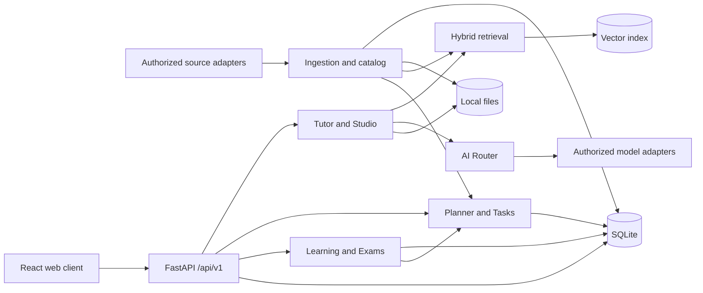

# Software architecture

Status: **RECOMMENDATION**, pending repository reconciliation and human approval. Design for a single-machine modular monolith with explicit service boundaries; avoid microservices, distributed queues and mandatory hosted infrastructure during the hackathon.

## Stack proposal
| Layer | Choice | Rationale / alternative |
|---|---|---|
| Client | React + TypeScript + Vite, React Router, Tailwind, accessible component primitives | Local SPA; Next.js only if existing repo warrants it |
| Server | Python 3.12, FastAPI, Pydantic, SQLAlchemy, Alembic | Python data/ML ecosystem, generated OpenAPI |
| State | SQLite WAL + FTS5, local blob files | Zero database service; PostgreSQL migration for shared deployment |
| Retrieval | Chroma persistent index + local multilingual Sentence Transformers | Avoid paid embedding dependency; exact-vector adapter for tests |
| Parsing | PyMuPDF, python-docx, python-pptx, nbformat; optional Docling/OCR | Preserve source anchors; inspect licensing and extraction quality |
| AI | Provider interface + direct SDK adapter for one authorized model; optional LiteLLM later; Ollama optional | Avoid provider lock-in and unverified free quotas |
| Planner | Deterministic greedy MVP; OR-Tools CP-SAT next | Fast baseline with hard constraints and fallback |
| Learning | Transparent evidence score + interval heuristic MVP; FSRS adapter later | Testable, no invented calibrated mastery model |
| UI libraries | FullCalendar, KaTeX, Markdown sanitizer, Recharts | Calendar, formulas, analytics |
| Jobs | SQLite job table + bounded single worker; optional APScheduler for recurring sync | Restart recovery without Redis/Celery |
| Delivery | npm + Python venv, Docker Compose optional, pytest/Vitest/Playwright, GitHub Actions | Reproducible local development |

## Boundaries and dependency direction
HTTP routers validate DTOs and call application services. Domain logic is pure Python and does not import FastAPI or provider SDKs. Application services depend on typed repository/provider/clock interfaces. Infrastructure implements those interfaces. Use module-owned models and migrations coordinated centrally; no service writes another module's tables directly. Cross-domain reads use small query interfaces, not ad hoc cross-module ORM object mutation.

Catalog owns identity, documents and concept revisions; ingestion owns connections, cursors and parse/index jobs; retrieval owns chunk search; AI owns generation/chat/provider usage; learning owns attempts, review, mastery and evidence; planner owns availability, tasks and sessions; workspace owns notes/focus; analytics reads derived data; notifications consumes change events. User context is injected server-side, not trusted from request body.

## Consistency and event flow
Use transaction + outbox for durable domain events, delivered at least once with handler deduplication: `DocumentIndexed`, `SourceChanged`, `AssessmentChanged`, `EvidenceRecorded`, `MasteryUpdated`, `SessionFinished`, `PlanAccepted`. Events include event_id, user_id, entity_id, revision, occurred_at and schema_version. A sync commits metadata before enqueuing index work. Index publication is atomic via active version switch after all chunks are written. A changed assessment marks plan dirty; a plan preview is based on calendar/learning revisions. Reject stale acceptance. Evidence is recorded once by unique attempt/item key; update mastery and due date in the same transaction or replay from immutable evidence.

## Security and reliability
Local-first does not mean air-gapped: external calls are opt-in and minimized. Bind loopback by default; local session auth, CSRF for cookie mutations, strict CORS, server-side secret vault/keyring or environment. Never send provider secrets to browser. Authorize every user-scoped read including search and citations. File paths are internal IDs, not raw client paths; MIME/size limits and safe archive handling. Treat imported content as untrusted data, never instructions; do not execute notebooks or generated code. Sanitize Markdown/HTML and media. Failures remain visible, with retries/backoff and explicit offline state.

## Evolution
Post-hackathon: move relational store to PostgreSQL, optionally pgvector, split worker process, add institutional authentication and authorized collaboration service. Keep storage/search/provider interfaces stable; migrations and tests precede changes. See [DECISIONS](DECISIONS.md) and [DEPLOYMENT](DEPLOYMENT.md).
